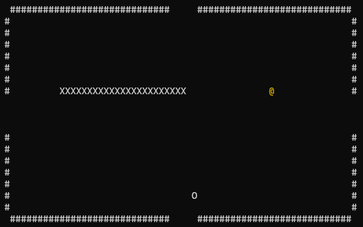

{:refdef: style="text-align: center;"}
{:height="1000" width="500"}
{:refdef}

I couldn't sleep yesterday, so I decided to have a crack at making my own version of the classic game Snake. Like many children of the 90s, I spent a lot of time playing this on Nokias. There's a gist with the same content [here](https://gist.github.com/swilcock0/ec369f58c8966ee653324f5ad215744e)

Similar to (I think it was) Snake II, I've added "super" foods, and some teleportation mechanics. 

```python
from unicurses import *
from random import randint
from time import sleep

def main():
    # Initialize screen
    stdscr = initscr()
    curs_set(0)  # Hide the cursor
    noecho()  # Turn off automatic echoing of input
    nodelay(stdscr, True)  # Non-blocking input
    keypad(stdscr, True)  # Enable arrow keys
    timeout(100)  # Default refresh timeout, will be adjusted per axis

    # Initialize color support
    start_color()
    init_pair(1, COLOR_RED, COLOR_BLACK)  # Red superfood
    init_pair(2, COLOR_YELLOW, COLOR_BLACK)  # Yellow superfood
    init_pair(3, COLOR_CYAN, COLOR_BLACK)  # Cyan superfood
    
    # Show splash screen
    attron(COLOR_PAIR(3))
    display_splashscreen()
    attroff(COLOR_PAIR(3))
    
    # Get screen dimensions
    sh, sw = getmaxyx(stdscr)  # Screen height and width
    
    # Initialize snake and food
    snake = [[sh // 2, sw // 2 + i] for i in range(3)]  # Snake body
    food = [randint(1, sh - 2), randint(1, sw - 2)]  # Food position
    mvaddch(food[0], food[1], ord('O'))  # Display food
    
    # Initialize super food variables
    super_food = None
    super_food_time = 0

    # Initial direction
    key = KEY_LEFT
    last_key = key
    
    while True:
        # Get updated screen dimensions
        sh, sw = getmaxyx(stdscr)  # Update screen height and width
        
        # Draw walls (hashes for the edges)
        for i in range(1, sw-1):
            mvaddch(0, i, ord('#'))  # Top wall
            mvaddch(sh-1, i, ord('#'))  # Bottom wall
        for i in range(1, sh-1):
            mvaddch(i, 0, ord('#'))  # Left wall
            mvaddch(i, sw-1, ord('#'))  # Right wall
        
        # Draw portals (5 chars wide and 3 chars tall for the left/right walls)
        mvaddstr(0, sw // 2 - 2, "     ")  # Top wall portal
        mvaddstr(sh - 1, sw // 2 - 2, "     ")  # Bottom wall portal
        for i in range(1, 4):
            mvaddch(sh // 2 - 2 + i, 0, ord(' '))  # Left wall portal (3 tall)
            mvaddch(sh // 2 - 2 + i, sw - 1, ord(' '))  # Right wall portal (3 tall)
            
        # Get user input
        next_key = getch()
        key = key if next_key == -1 else next_key
        
        # Prevent "double-back" moves/deaths
        if last_key == KEY_LEFT and key == KEY_RIGHT:
            key = KEY_LEFT
        elif last_key == KEY_RIGHT and key == KEY_LEFT:
            key = KEY_RIGHT
        elif last_key == KEY_UP and key == KEY_DOWN:
            key = KEY_UP
        elif last_key == KEY_DOWN and key == KEY_UP:
            key = KEY_DOWN
        last_key = key
        
        # Compute new head position based on direction
        head = snake[0]
        if key == KEY_DOWN:
            new_head = [head[0] + 1, head[1]]
        elif key == KEY_UP:
            new_head = [head[0] - 1, head[1]]
        elif key == KEY_LEFT:
            new_head = [head[0], head[1] - 1]
        elif key == KEY_RIGHT:
            new_head = [head[0], head[1] + 1]
        else:
            continue  # Ignore invalid keys

        # Check for self-collision (before adding the new head)
        if new_head in snake:
            break  # End game if snake crashes into itself
        
        # Check for portal mechanics (teleporting when hitting a portal)
        # Top and bottom wall portals
        if new_head[0] == 0 and sw // 2 - 2 <= new_head[1] <= sw // 2 + 2:  # Top wall portal
            new_head = [sh - 2, new_head[1]]  # Teleport to bottom
        elif new_head[0] == sh - 1 and sw // 2 - 2 <= new_head[1] <= sw // 2 + 2:  # Bottom wall portal
            new_head = [1, new_head[1]]  # Teleport to top
        # Left and right wall portals
        elif new_head[1] == 0 and sh // 2 - 1 <= new_head[0] <= sh // 2 + 1:  # Left wall portal
            new_head = [new_head[0], sw - 2]  # Teleport to right
        elif new_head[1] == sw - 1 and sh // 2 - 1 <= new_head[0] <= sh // 2 + 1:  # Right wall portal
            new_head = [new_head[0], 1]  # Teleport to left

        # Check for collision with regular walls (after portal check)
        if (
            new_head[0] in [0, sh-1] or
            new_head[1] in [0, sw-1] and
            not (new_head[0] == sh // 2 and sw // 2 - 2 <= new_head[1] <= sw // 2 + 2)  # Exclude portal zones
        ):
            break  # End game on collision with a wall (not a portal)

        # Add the new head to the snake
        snake.insert(0, new_head)

        # Check if food is eaten
        if new_head == food:
            food = [randint(1, sh - 2), randint(1, sw - 2)]
            mvaddch(food[0], food[1], ord('O'))
        else:
            # Remove tail
            tail = snake.pop()
            mvaddch(tail[0], tail[1], ' ')

        # Check if super food is eaten
        if super_food and new_head == super_food:
            # Extend snake by 10 units
            for _ in range(10):
                snake.append(snake[-1])  # Add new segments to snake body
            super_food = None  # Remove super food

        # Display the snake
        for segment in snake:
            mvaddch(segment[0], segment[1], ord('X'))

        mvaddch(food[0], food[1], ord('O'))  # Ensure food is always drawn

        # Display the super food (if any)
        if super_food:
            # Flash the super food in different colors
            if super_food_time % 2 == 0:
                attron(COLOR_PAIR(1))
                mvaddch(super_food[0], super_food[1], ord('S'))
                attroff(COLOR_PAIR(1))
            else:
                attron(COLOR_PAIR(2))
                mvaddch(super_food[0], super_food[1], ord('@'))
                attroff(COLOR_PAIR(2))
            super_food_time += 1
            if super_food_time > 100:  # Super food lasts for 10 seconds (20 timeouts)
                mvaddch(super_food[0], super_food[1], ' ')
                super_food = None
                super_food_time = 0

        refresh()

        snake_length = len(snake)
        if snake_length > 400:
            snake_length = 400
        x_scale = (sw / (sw + sh)) * (1 - (snake_length / 400))
        y_scale = (sh / (sw + sh)) * (1 - (snake_length / 400))        

        # Adjust the refresh timeout based on direction
        if key == KEY_LEFT or key == KEY_RIGHT:
            timeout(int(100 * y_scale))
        elif key == KEY_UP or key == KEY_DOWN:
            timeout(int(100 * x_scale))
            
                        
        # Chance to spawn super food, but only if none exists already
        if not super_food and randint(1, 100) <= 5:  # 5% chance per frame
            super_food = [randint(1, sh - 2), randint(1, sw - 2)]
            # Ensure the super food does not spawn on the snake or regular food
            while super_food in snake or super_food == food:
                super_food = [randint(1, sh - 2), randint(1, sw - 2)]

    # Display "Game Over" message
    display_game_over(stdscr, sh, sw, len(snake))

    # End the game
    endwin()

def display_game_over(stdscr, sh, sw, score=-1):
    """Displays a centered 'Game Over' message."""
    clear()  # Clear the screen
    box_width = 20
    box_height = 6
    box_start_y = (sh // 2) - (box_height // 2)
    box_start_x = (sw // 2) - (box_width // 2)
    
    # Draw box
    for i in range(box_height):
        mvaddch(box_start_y + i, box_start_x, '|')
        mvaddch(box_start_y + i, box_start_x + box_width - 1, '|')
    for j in range(box_width):
        mvaddch(box_start_y, box_start_x + j, '-')
        mvaddch(box_start_y + box_height - 1, box_start_x + j, '-')

    # Display text
    message = " GAME OVER "
    mvaddstr(box_start_y + 2, box_start_x + (box_width // 2 - len(message) // 2), message)
    message = " SCORE : " + str(score)
    mvaddstr(box_start_y + 3, box_start_x + (box_width // 2 - len(message) // 2), message)
    refresh()
    sleep(5)
    clear()  # Clear the screen after game over

def display_splashscreen():
    """Displays a splash screen with ASCII art and the game title."""
    splash_text = """
 $$$$$$\   $$$$$$\  $$\      $$\ $$\      $$\ $$\     $$\        $$$$$$\  $$\   $$\  $$$$$$\  $$\   $$\ $$$$$$$$\ 
$$  __$$\ $$  __$$\ $$$\    $$$ |$$$\    $$$ |\$$\   $$  |      $$  __$$\ $$$\  $$ |$$  __$$\ $$ | $$  |$$  _____|
$$ /  \__|$$ /  $$ |$$$$\  $$$$ |$$$$\  $$$$ | \$$\ $$  /       $$ /  \__|$$$$\ $$ |$$ /  $$ |$$ |$$  / $$ |      
\$$$$$$\  $$$$$$$$ |$$\$$\$$ $$ |$$\$$\$$ $$ |  \$$$$  /        \$$$$$$\  $$ $$\$$ |$$$$$$$$ |$$$$$  /  $$$$$\    
 \____$$\ $$  __$$ |$$ \$$$  $$ |$$ \$$$  $$ |   \$$  /          \____$$\ $$ \$$$$ |$$  __$$ |$$  $$<   $$  __|   
$$\   $$ |$$ |  $$ |$$ |\$  /$$ |$$ |\$  /$$ |    $$ |          $$\   $$ |$$ |\$$$ |$$ |  $$ |$$ |\$$\  $$ |      
\$$$$$$  |$$ |  $$ |$$ | \_/ $$ |$$ | \_/ $$ |    $$ |          \$$$$$$  |$$ | \$$ |$$ |  $$ |$$ | \$$\ $$$$$$$$\ 
 \______/ \__|  \__|\__|     \__|\__|     \__|    \__|           \______/ \__|  \__|\__|  \__|\__|  \__|\________|
    """
    
    snake_art = r"""
           /^\/^\
         _|__|  O|
\/     /~     \_/ \
 \____|__________/  \
        \_______      \
                `\     \                 \
                  |     |                  \
                 /      /                    \
                /     /                       \\
              /      /                         \ \
             /     /                            \  \
           /     /             _----_            \   \
          /     /           _-~      ~-_         |   |
         (      (        _-~    _--_    ~-_     _/   |
          \      ~-____-~    _-~    ~-_    ~-_-~    /
            ~-_           _-~          ~-_       _-~
               ~--______-~                ~-___-~
    """

    # Combine splash text and snake art
    splash_screen = splash_text + "\n\n" + snake_art
    
    clear()  # Clear the screen before displaying splash screen
    mvaddstr(0, 0, splash_screen)  # Print the splash screen at the top left
    refresh()  # Refresh to display the content
    sleep(2)  # Wait for 2 seconds before moving on
    clear() # Clear the screen after splash screen

if __name__ == "__main__":
    main()
    
    endwin()
```