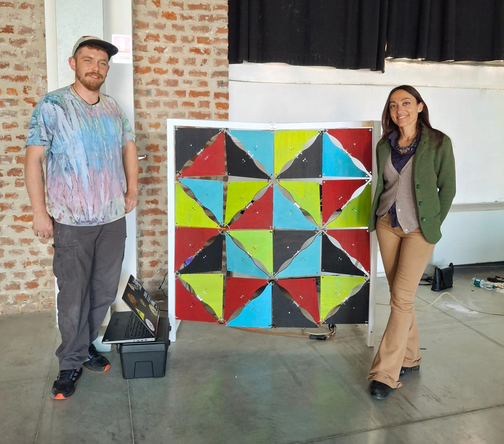
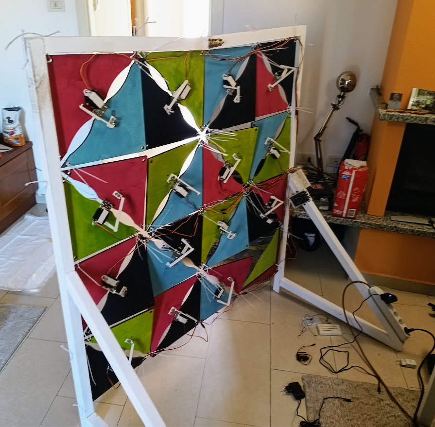
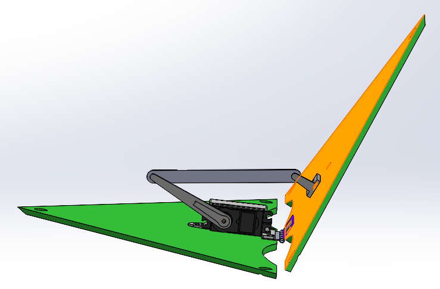

The sculpture having a rest

As part of Milan Design Week 2025, we were invited to represent Politecnico di Milano with a contribution to the event [Metamorphosis: Transforming Italian Architecture](https://www.metamorphosisarchfest.com/en/project/). For this, we devised a kinetic sculpture consisting of 32 isoceles triangle panels, with servo motors across the triangles' longest edges to allow rotation of the panels relative to each other. 

Assembly in my kitchen, showing the motor mechanisms

The mechanism was first designed in Solidworks, and then I derived the mechanism loop equations by hand to find the relationship between the servo angle and the angle of the panel. The equation was nonlinear and awkward, so I ended up fitting a 2nd order polynomial to it to drive the motor control, so that I could specify the angles between panels. 

Solidworks: Close-up on the mechanism

The original idea (and one that we'd like to follow in future) was to model a material surface, using a combination of Verlet integration to create interactions between a "cloth" and particles hitting it, and the Kabsch algorithm to fit the surface model to the constrained triangular panels to find the closest representative mesh that could be created with the rigid panels.

{:refdef: style="text-align: center;"}
<video width="800" height="600" controls preload="metadata" poster="/assets/img/Posts/fitting5-poster.jpg">
  <source src="/assets/video/fitting5.mp4" type="video/mp4">
  Your browser does not support the video tag.
</video>


Verlet integration representation and Kabsch rigid transformation fitting

{:refdef}

Time wasn't on our side for the programming and the Raspberry Pi died(!) so instead, we ended up with this glitchy Arduino driven structure instead. 

{:refdef: style="text-align: center;"}
<video width="800" height="600" controls preload="metadata" poster="/assets/img/Posts/2025-04-09-Arlecchino-poster.jpg">
  <source src="/assets/video/2025-04-09-Arlecchino.mp4" type="video/mp4">
  Your browser does not support the video tag.
</video>


The end structure in motion

{:refdef}