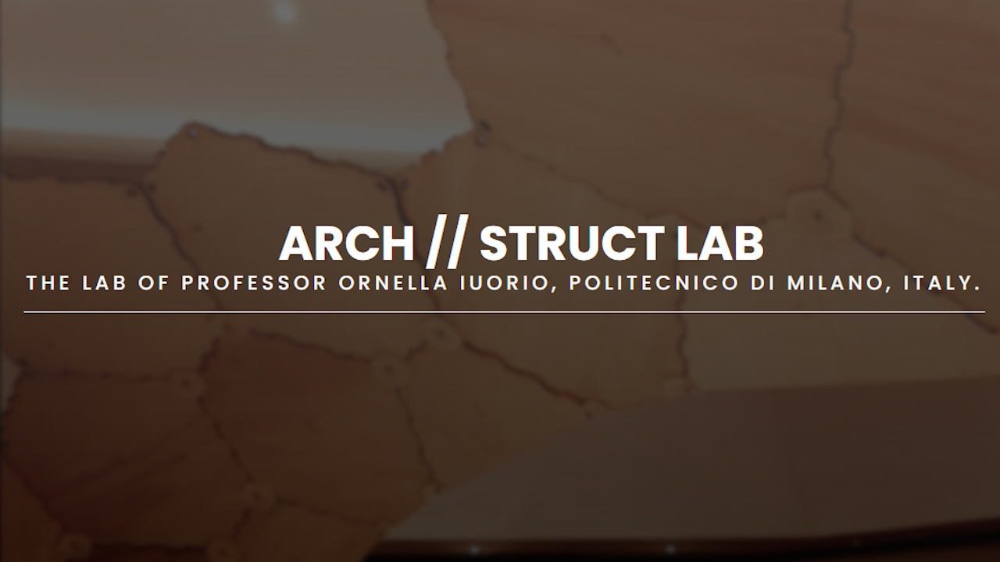

For our research lab, I've recently created a new website to showcase our research projects and maintain a single source for our publications history. See the end result [here](https://archstructlab.com)