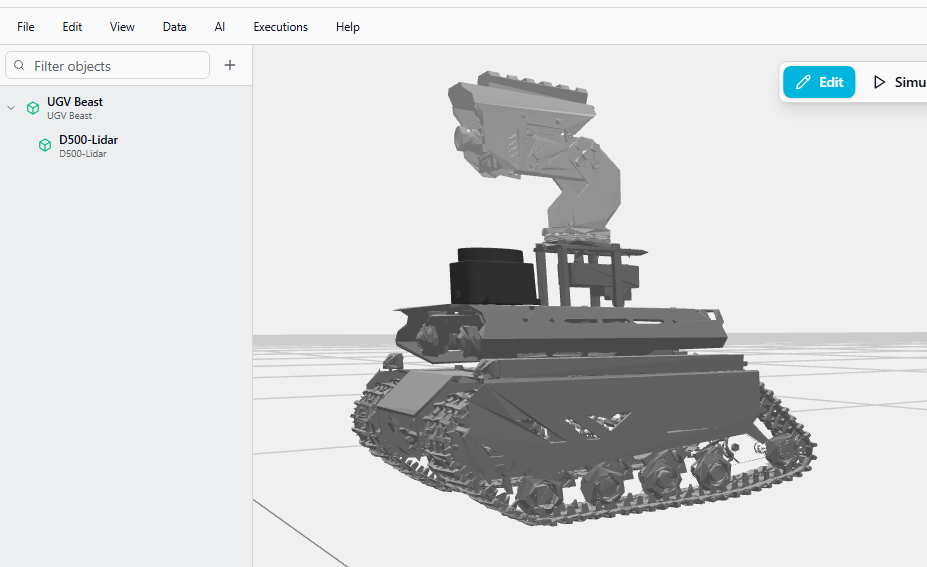
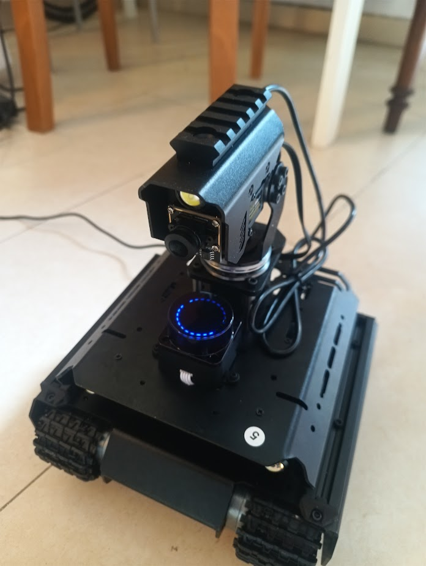
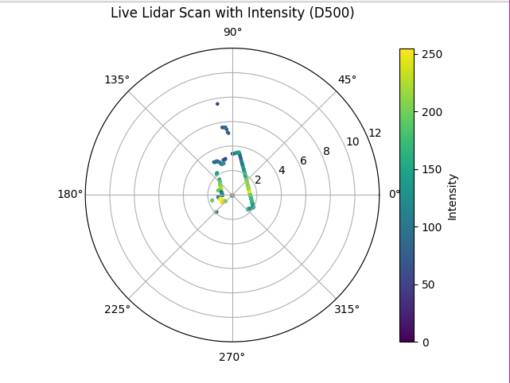
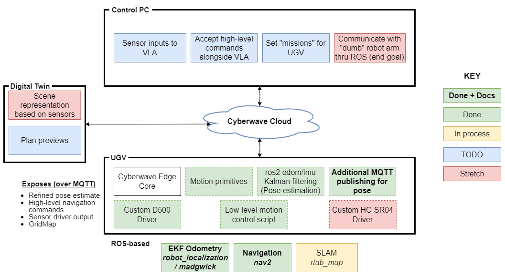

UGV with lidar in Cyberwave Digital Twin environment

I often think that many foundational parts of robotics are basically plumbing: piping data from A to B, keeping interfaces clean, and making sure the whole system still behaves once real hardware gets involved. That is a big part of why I have been enjoying working with Milan/Zürich company [Cyberwave](https://cyberwave.com). Their architecture makes this sort of systems integration much less painful than it usually is.

As part of their [Builder's Cohort](https://cyberwave.com/built-with-cyberwave), they sent me a **UGV Beast** and said "make something". So far, I have been setting up navigation and odometry through extended Kalman filters and the ROS 2 navigation stack, while wiring everything into the Cyberwave platform and its digital twin model.

Real robot with lidar (such a pretty colour of blue!)

The most recent addition was a **Waveshare D500 lidar** / **LDRobot LD19** kit. The physical UART connection was a little more dramatic than I would have liked, especially late in the evening, but the software side was refreshingly smooth. Using Cyberwave's driver-skill pattern, I had a finished driver up, connected, and publishing through the Cyberwave cloud layer within about two hours.

Lidar scan polar plot

That is the part I find most exciting: once the sensor is represented properly in the platform, it stops being a device tethered to one serial port on one robot. It becomes part of a cloud-connected system. I now have a digital twin of the sensor inside the wider robot model, can query it remotely, and can send summaries of the data into cloud-provisioned workflows, including experiments with **Gemini Robotics ER**.

Action plan

I have been documenting the process in my live learning repository, including the ROS 2 integration work, EKF setup, and the step-by-step driver creation workflow:

- [cyberwave-learning](https://github.com/swilcock0/cyberwave-learning)
- [cyberwave-edge-d500-lidar-driver](https://github.com/swilcock0/cyberwave-edge-d500-lidar-driver)

The learning repository goes into much more detail on creating the driver, publishing `LaserScan`-style telemetry, and attaching the sensor into the Cyberwave catalogue and environment model. More updates to come once I push the navigation side further.

<video controls autoplay loop muted playsinline preload="metadata" poster="/assets/img/Posts/2026-04-15-UGV-poster.jpg" style="margin: 0 auto; display: block; max-width: 100%;">
  <source src="/assets/img/Posts/UGV.mp4" type="video/mp4">
  Your browser does not support the video tag.
</video>


Live test

*Update, September 2026:* the UGV has since become the mobile scout in our [heterogeneous robot team](/posts/2026-09-14-Heterogeneous-robot-teams/) for assembly on cluttered sites.
