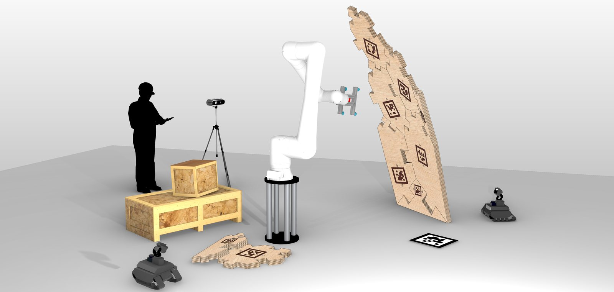
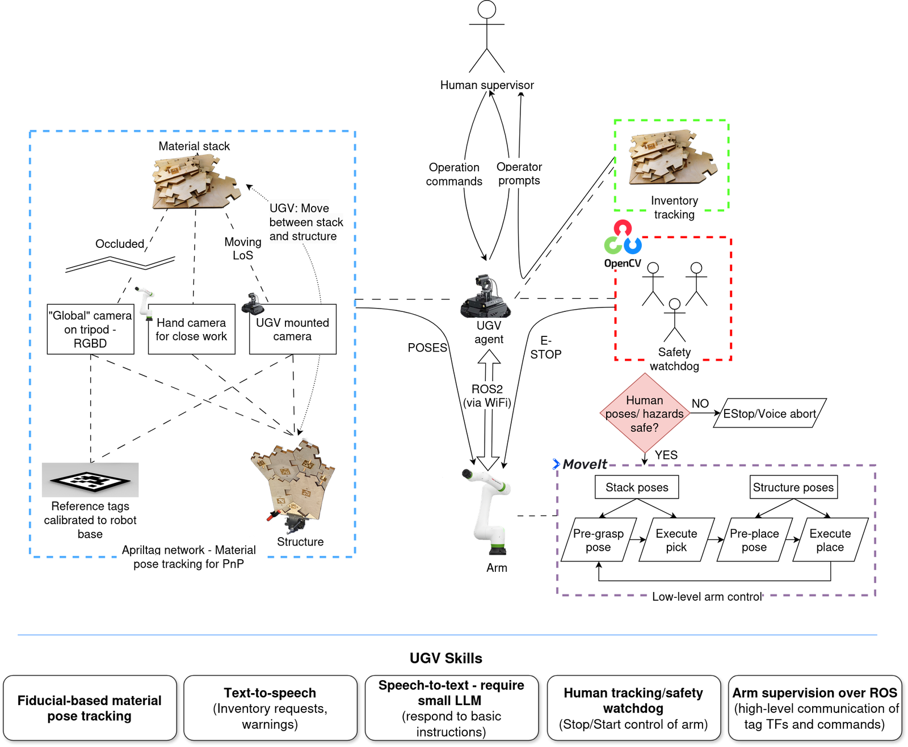
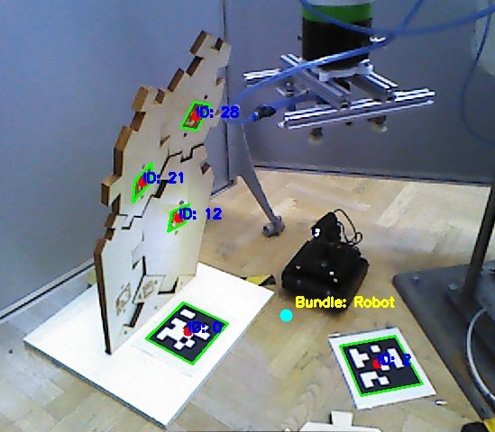
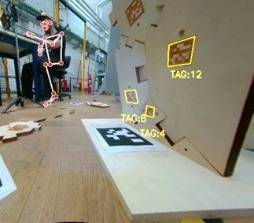
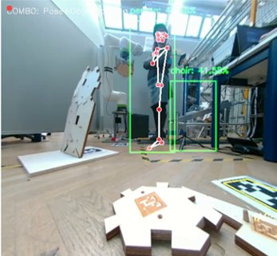
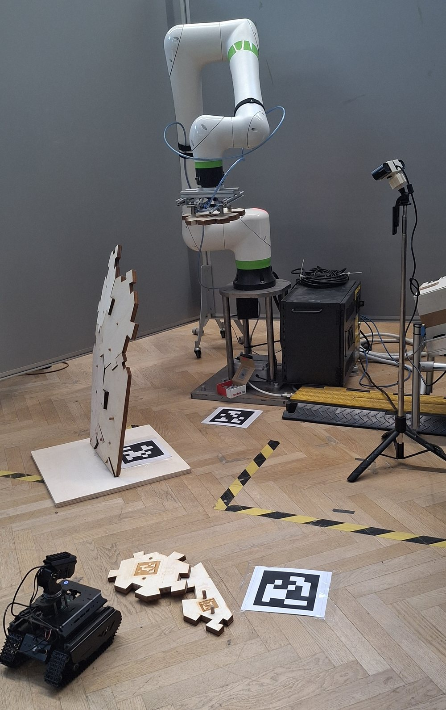

The proposed team: a human supervisor, a stationary arm and a mobile rover working around a panel structure

Most robotic fabrication still happens in the lab: a clean concrete floor, cameras bolted in fixed positions, and nothing in the way. That has produced some wonderfully complex architecture, but it also means the robots stop at the door of an actual building site, where the floor is uneven, materials are piled wherever there was space, and people keep walking through.

In a short paper for *Robotics in Architecture* (in press), Ornella Iuorio and I propose flipping that around: treat the clutter as a normal site condition to work within, rather than something to clear away first, and split the job across a small team of different robots.

## The team

The fleet pairs two very different machines:

- a stationary **Fanuc CRX-10iA/L** arm with a vacuum gripper (the same arm from my [light painting](/posts/2024-10-08-Light-painting/) experiments), which does the precise work of picking and placing panels;
- a mobile **Waveshare UGV Beast** rover (the one from my [Cyberwave lidar post](/posts/2026-04-15-Cyberwave-Lidar/)), which does the legwork: moving around the site, finding panels and checking the structure.

The panels themselves carry [AprilTags](https://april.eecs.umich.edu/software/apriltag), building on our earlier work on [laser-cut panel systems for robotic assembly](https://archstructlab.com/publications/25-laser-robot), so any camera that can see a tag knows exactly where that panel is and which way it faces.

System architecture: tag tracking, inventory, human-pose safety and MoveIt arm control, coordinated over ROS 2 with a voice interface for the operator (click for full size)

## Why one camera isn't enough

A single fixed "global" camera on a tripod gives a useful overview of the workspace, especially the structure being built. But on a real site it misses things: tags that are too far away, badly lit or hidden behind something simply don't register.

The global camera's view: two of the tags don't register because of lighting and distance

So the sensing is spread across the team instead. The rover carries an RGB-D camera and acts as a mobile scout, driving between the material stack and the structure, using its lidar to get around obstacles. It also has adjustable LEDs, so it can change the lighting locally and move round to a better angle to read tags the global camera missed. As it goes, it keeps a running log of where every known panel is. The arm has its own camera on the end effector for close-up checks.

The rover moves and changes its lighting to pick up tags it couldn't see

Human pose recognition: a nearby person can slow or stop the arm

## How a panel gets picked and placed

All the tags are calibrated relative to the fixed arm, so every robot reports poses in one shared reference frame. Picking then follows a discover, hand over, verify loop:

1. **Discover.** The rover works its way around the clutter and measures the full 3D position and orientation of each panel it finds, relative to its own chassis.
2. **Hand over.** It sends those poses over local WiFi to the arm's control PC, which handles the motion planning and inverse kinematics with MoveIt.
3. **Verify.** As the arm approaches, its end-effector camera re-checks the tag up close before switching on the vacuum gripper.
4. **Recover.** If that check fails, because something has shifted, the arm backs off to a neutral pose and the rover is sent to look at the panel from another angle to get a better estimate.

Placement works the same way in reverse: the rover inspects the structure and, together with the global camera, refines where the next panel should go.

The arm places a panel with the vacuum gripper while the rover checks the inventory

## A person in the loop, by voice

Rather than a screen full of buttons, we propose that the human works as a supervisor through a speech interface on the rover. An LLM-based agent maps plain-language requests onto a library of ROS "skills", so "get a better view" or "redo panel" become actions, and a small local speech-to-text model takes over when there's no network, which on a building site is often. It goes both ways: the rover can ask for the material stack to be restocked, or say when a panel is physically out of reach.

Underneath that runs a safety loop. Object and human-pose recognition watch the workspace continuously, and depending on how close someone is and how they're positioned, the arm slows down or stops. A spoken "pause" works even offline.

## Where it goes next

This is a conceptual workflow more than a finished system, but it points somewhere interesting: a small, decentralised robotic workforce that works *with* the mess of a real site instead of needing a lab built around it. Obvious next steps are more agents (extra rovers searching for material in parallel, or drones for mapping at several heights) and richer reasoning in the robots themselves, so more of the day-to-day site coordination can be handed over.

Thanks to MeRLIn Lab and Fanuc for the arm, and to [Cyberwave](https://cyberwave.com) for the UGV Beast.
