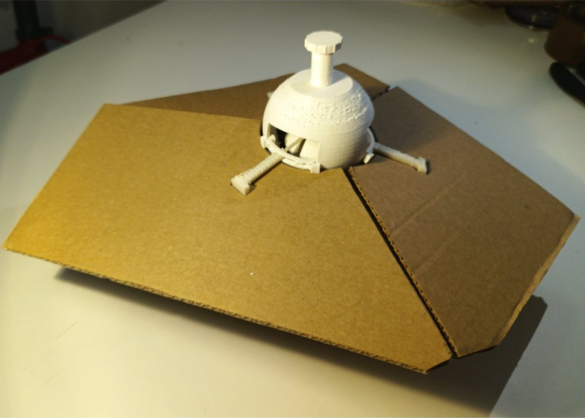
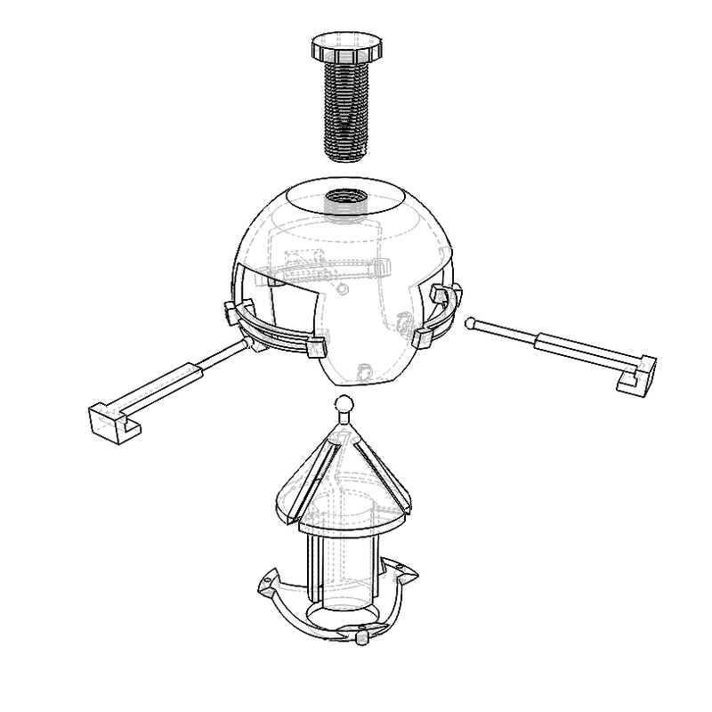
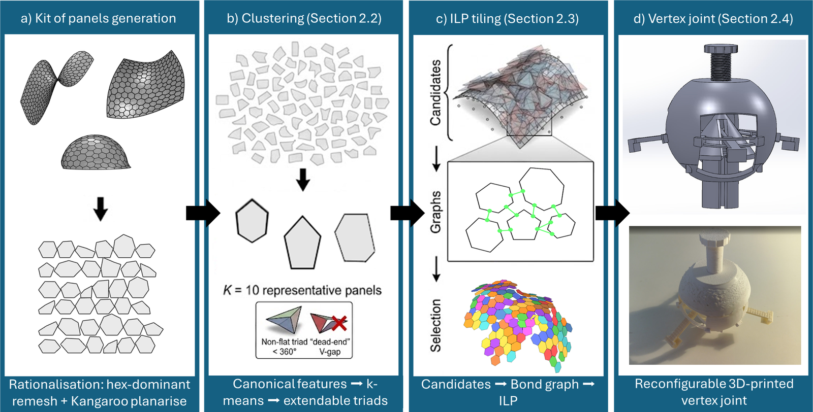
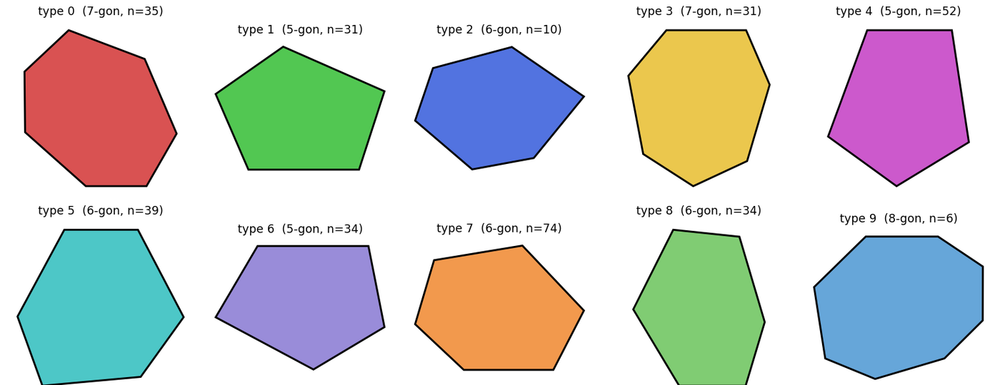
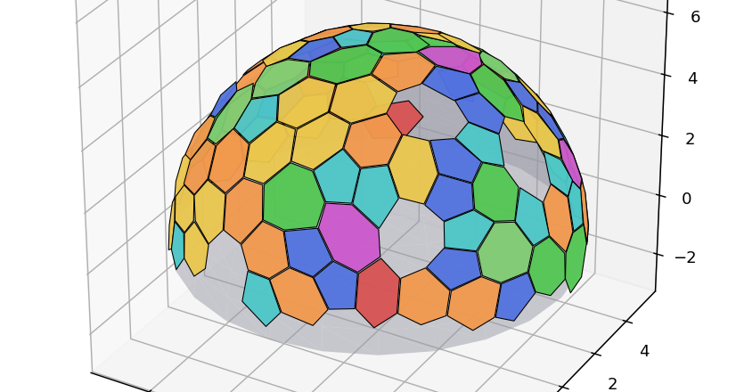

The printed joint pulling three cardboard panels into a locked, folded configuration

Curved shells are lovely, efficient structures, but building one out of flat panels usually means every panel and every connector is a one-off. Cut them, assemble them once, and when the structure comes down the parts are only good for that one shape. At the [IASS 2026 Symposium](https://www.iass-iwss2026.org/info/) in Turin this month, Emil Korkis, Ornella Iuorio and I presented a different approach: design one finite **kit of parts**, and let the geometry work out how that same kit can be rearranged into many different curved structures.

The paper is [A reconfigurable hardware-geometry system for the assembly of multiple structures from finite panel kits and adaptable nodes](https://archstructlab.com/publications/26-reconfigurable-panel-kits) ([PDF](https://archstructlab.com/download/pubs/26-reconfigurable-panel-kits.pdf)).

## Why a kit of parts is hard for curved surfaces

The kit-of-parts idea is simple: a fixed palette of standard components gives you variety through combination rather than bespoke fabrication. It works well for flat and singly curved structures. Doubly curved surfaces (domes, saddles, blobs) are where it falls apart, because flat panels can't lie tangent to a surface that curves in two directions. Unless the joint, the panel shapes and the design software are planned together, adjacent panels simply don't fit each other often enough to cover a curved surface continuously.

So the core idea of the paper is to couple all three: a physical joint with known limits, a panel kit chosen to suit those limits, and a tiling algorithm that only ever proposes arrangements the joint can actually build.

## The joint

Exploded view of the vertex joint: three arms, sliding cuffs, a rotating collar and a central locking screw

Each node is a 3D-printed joint connecting exactly three panels at a shared corner. Every arm has two bounded freedoms:

- **Fold:** the panel can fold from 50° closing to 10° past flat. The deep closing range is what lets a surface curve; the small overextension soaks up assembly slack.
- **Twist:** a collar allows ±30° of in-plane rotation around the neutral 120° spacing, which means panel corners anywhere from 90° to 150° can meet at a node.

Both are free only while you're placing panels. Tightening a single screw down the joint's axis drives a conical wedge against all three arms and locks fold and rotation in one go, so the stiffness comes from the screw preload rather than the printed sliding parts.

Those limits define the design space. Anything the software proposes has to fit inside them.

## From a design to a finite kit

The four-stage pipeline, from generated panels to a physical joint

The workflow has four stages.

1. **Generate realistic panels.** A Grasshopper script produces 100 variations each of domes, hypars and blobs, covers them in hex-dominant meshes and flattens every face with Kangaroo. That gives a large population of buildable flat panels across a wide range of curvatures.
2. **Cluster them into a kit.** Each panel becomes a fingerprint of its edge lengths and corner angles, made independent of which corner you start from or which way round you go, and k-means groups them into a small number of panel types.
3. **Find the corners that work.** The software lists every way three panels from the kit can meet at a joint within its fold limits (we call these triads), then repeatedly removes any triad that leads to a dead end where no other triad could continue the surface.
4. **Tile a target surface.** Growing panels outward greedily drifts and self-intersects on a curved surface, so instead the method generates a deliberately over-complete pool of overlapping candidate placements and lets an integer linear programme choose the best non-overlapping, well-connected subset. It also respects how many of each panel type physically exist in the kit, which is the decision a greedy method can't make.

## What came out

The ten base panel types in the selected kit

A sweep over kit sizes showed that more panel types isn't automatically better. Ten types with two standard edge lengths gave over 400 usable triads and the most curved ones (81), whereas 15 or 20 types fragmented the edge lengths so badly that fewer panels could meet each other. With mirrored copies that makes 20 distinct tiles, and the curved configurations mostly fold by 10–30°.

A hemispherical dome tiled from the kit; colour shows panel type

We tiled a flat plane, a hemispherical dome and a designed shell from the same kit, and built a first physical test with cardboard panels and a PLA-printed joint. The locking mechanism engaged reliably.

## What's next

The tilings still leave some holes, either where the candidate pool never offered a panel or where a corner is sharper than the kit's smallest angle. Enriching the kit with more acute panels, adding triangles or quads for saddle-shaped regions, and letting the optimiser choose panel types more freely are the next steps. The other big one is structural: load-testing the locked joint and building at full scale to measure real assembly tolerances and how much effort a reconfiguration actually takes.

If you're working on reusable or demountable structures and want to compare notes, .
