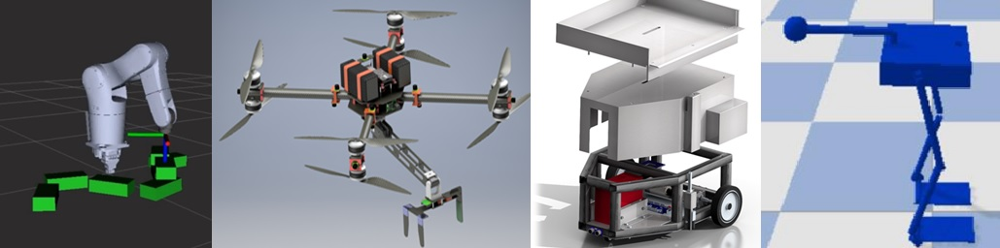

<meta property="og:description" content="Sam Wilcock is a research fellow in the Department of Architecture, Built Environment and Construction at the Politecnico di Milano, using robots to build structures." />
{:refdef: style="text-align: center;"}

{:refdef}

<!--author-->

